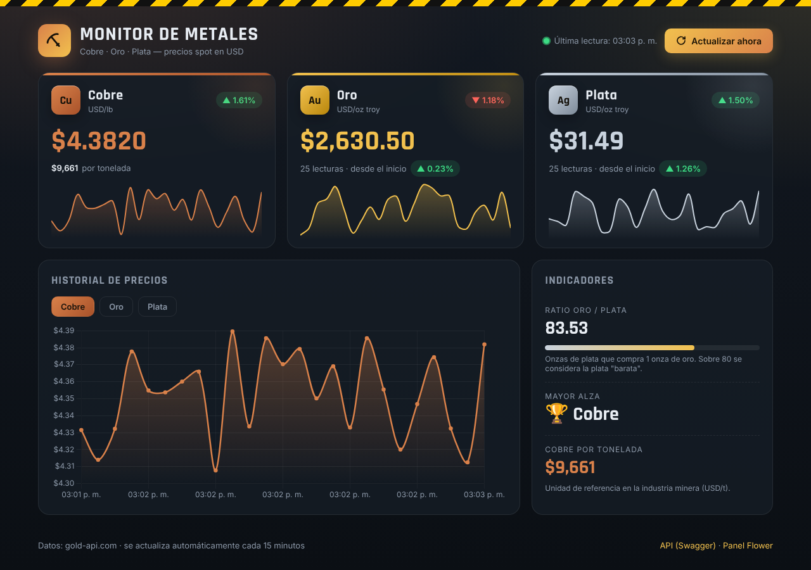

# Task Worker System

Sistema de **tareas distribuidas en segundo plano**: una API recibe los pedidos y los deja en una cola, y unos *workers* los procesan en paralelo sin bloquear al usuario. Todo corre en contenedores con **Docker Compose**.


## 🖥️ Panel visual



*Captura con datos de ejemplo.* Al levantar el proyecto, abre **http://localhost:8000** para ver los precios del cobre, oro y plata con gráficos, variaciones e indicadores. La pantalla se refresca cada minuto y tiene un botón para actualizar al instante.

## Arquitectura

```
 Cliente ──► API (FastAPI :8000) ──► Redis (cola) ──► Worker (Celery, 4 procesos)
                    ▲                                        │
                    └──────── consulta estado ◄── Redis (resultados)

   Beat (cada 15 min) ──► Redis (cola) ──► Worker ──► API de precios de metales

                         Flower (:5555) monitorea los workers
```

| Servicio | Función |
|---|---|
| `api` | Recibe peticiones, encola la tarea y responde al instante con un `task_id` |
| `redis` | Broker (cola de mensajes, DB 0) y almacén de resultados (DB 1) |
| `worker` | Ejecuta las tareas pesadas en paralelo y reporta el progreso |
| `beat` | Reloj que lanza automáticamente la actualización de precios cada 15 minutos |
| `flower` | Panel web para ver en vivo las tareas y los workers |

## 📈 Monitor de precios de metales

Cada 15 minutos el sistema consulta automáticamente el precio spot del **cobre, oro y plata** (API pública [gold-api.com](https://gold-api.com), sin API key), guarda el historial y calcula la comparación.

| Endpoint | Qué devuelve |
|---|---|
| `GET /metals/prices` | Último precio de cada metal, variación % contra la lectura anterior y contra la primera, **ratio oro/plata** y el metal con mayor alza |
| `GET /metals/history/{HG\|XAU\|XAG}?limit=50` | Historial de un metal (HG = cobre, XAU = oro, XAG = plata) |
| `POST /metals/update` | Fuerza una actualización inmediata |

El cobre se entrega en USD/lb y también en **USD por tonelada métrica**, que es la unidad habitual en la industria minera.

Ejemplo de respuesta de `GET /metals/prices`:

```json
{
  "metales": {
    "HG":  {"metal": "Cobre", "precio": 4.3114, "unidad": "USD/lb", "precio_tonelada": 9504.99, "variacion_vs_anterior_pct": -0.12},
    "XAU": {"metal": "Oro",   "precio": 2657.75, "unidad": "USD/oz troy", "variacion_vs_anterior_pct": -0.14},
    "XAG": {"metal": "Plata", "precio": 31.26, "unidad": "USD/oz troy", "variacion_vs_anterior_pct": 0.31}
  },
  "ratio_oro_plata": 85.01,
  "mayor_alza": "Plata"
}
```

Para cambiar la frecuencia, edita `METALS_UPDATE_MINUTES` en el servicio `beat` de `docker-compose.yml`.

## Otras tareas disponibles

- **Redimensionar imágenes** (`POST /tasks/resize`): procesa una imagen con Pillow y la guarda en `output/`.
- **Envío masivo de correos** (`POST /tasks/emails`): simula el envío uno por uno y reporta el avance en %.
- **Consultar estado** (`GET /tasks/{task_id}`): devuelve `PENDING`, `STARTED`, `PROGRESS`, `SUCCESS` o `FAILURE`.

## Cómo ejecutarlo

Requisitos: Docker Desktop.

```bash
git clone https://github.com/04sebastian2002/task-worker-system.git
cd task-worker-system
docker compose up --build
```

> En Windows, si `docker` abre una ventana preguntando con qué programa abrirlo, usa `docker.exe compose up --build`.

| URL | Qué es |
|---|---|
| http://localhost:8000 | **Panel visual** de precios de metales |
| http://localhost:8000/docs | Documentación interactiva de la API (Swagger) |
| http://localhost:5555 | Panel de monitoreo Flower |

## Ejemplo de uso

```bash
# 1. Encolar un envío de correos
curl -X POST http://localhost:8000/tasks/emails \
  -H "Content-Type: application/json" \
  -d '{"recipients": ["a@mina.com", "b@mina.com", "c@mina.com"], "subject": "Turno", "body": "Cambio de turno 07:00"}'
# → {"task_id": "abc123...", "status": "encolada"}

# 2. Consultar el progreso
curl http://localhost:8000/tasks/abc123...
# → {"state": "PROGRESS", "progress": {"enviados": 2, "total": 3, "percent": 66}}
```

## Aplicaciones en minería

Este mismo patrón (API + cola + workers) sirve para procesos de faena que tardan y no deben bloquear al usuario:
- Seguir el precio del cobre, oro y plata (ya incluido 👆)
- Procesar lecturas de sensores y telemetría de equipos
- Generar reportes de producción por turno
- Enviar alertas y notificaciones masivas al personal
- Procesar imágenes de inspección o de drones

## Escalar

Para tener más workers en paralelo:

```bash
docker compose up --scale worker=3
```

---
Autor: [04sebastian2002](https://github.com/04sebastian2002)
